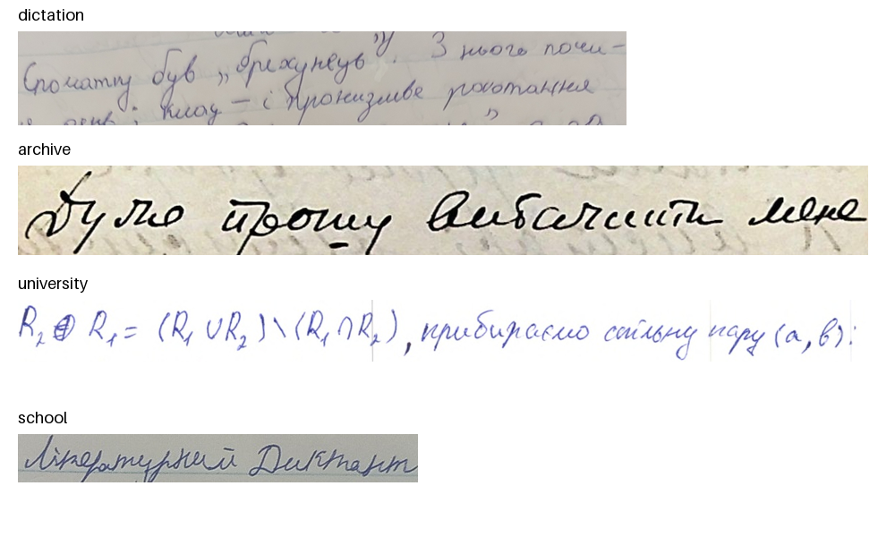
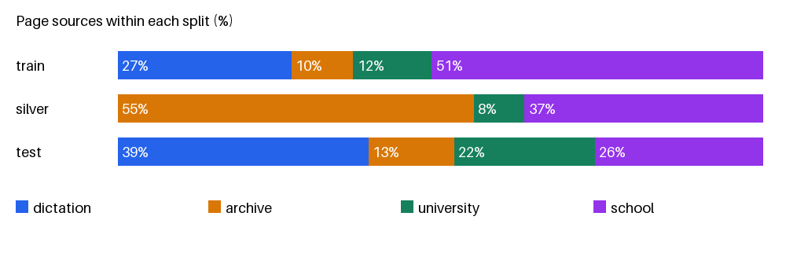
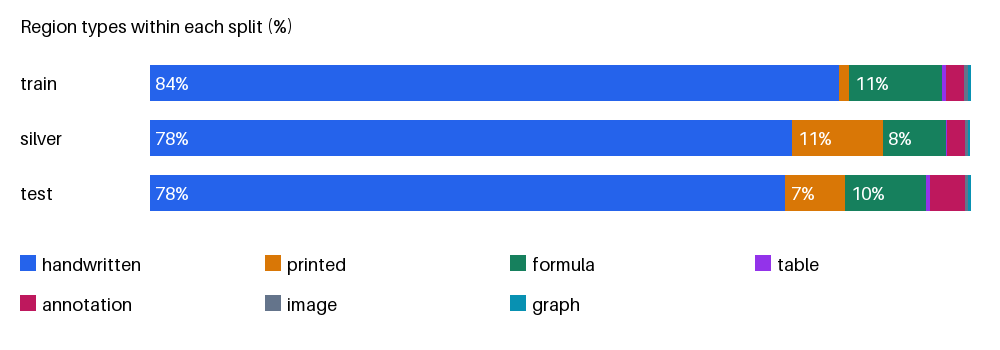

# RUKOPYS EDA

Snapshot: `78697007cfa5f77aae5d3b9fcedfac3169f84fb6`. Descriptive EDA includes train, silver, and test; use validation for tuning.

| Split | Pages | Regions | HTR candidates | Median text length |
| --- | --- | --- | --- | --- |
| train | 1,330 | 25,651 | 21,370 | 32 |
| silver | 9,020 | 190,382 | 141,858 | 30 |
| test | 385 | 8,290 | 6,347 | 32 |

HTR candidates are non-empty, legible Ukrainian handwritten labels; lengths count characters, not tokens.

## Examples and distributions

Four training-line crops, one per source. Source: RUKOPYS/UCU, CC BY 4.0; cropped/resized.

Silver is archive-heavy and has no dictation pages. The test source mixture differs from training.

Handwriting dominates; tables and graphs are rare.

## Checks that affect training

| Check | Train | Silver | Test |
| --- | --- | --- | --- |
| Missing images | 0 | 0 | 0 |
| Invalid boxes | 0 | 0 | 0 |
| Image/metadata size mismatch | 0 | 0 | 0 |
| Non-default EXIF orientation | 27 | 184 | 3 |
| Empty legible labels | 3 | 0 | 20 |
| Image/graph regions with text | 0 | 101 | 0 |

Exact duplicate extra copies: train 0, silver 1, test 0; 0 shared hash groups across splits. Hashes do not detect near-duplicates.

Keep boxes aligned when handling EXIF orientation. Image/graph targets should be empty. Keep official test annotations unchanged for comparable evaluation.

## Empty training transcripts

These three regions are marked legible but have no text.

- `images/29599939-58a2-4a48-b66a-bec206a5ea05.jpg, region 0 (printed)`
- `images/244c0285-bc6c-4697-afa5-9fe257ea625d.jpg, region 1 (annotation)`
- `images/0c3d0d34-544e-4769-bf13-67558a2974ee.jpg, region 40 (annotation)`
