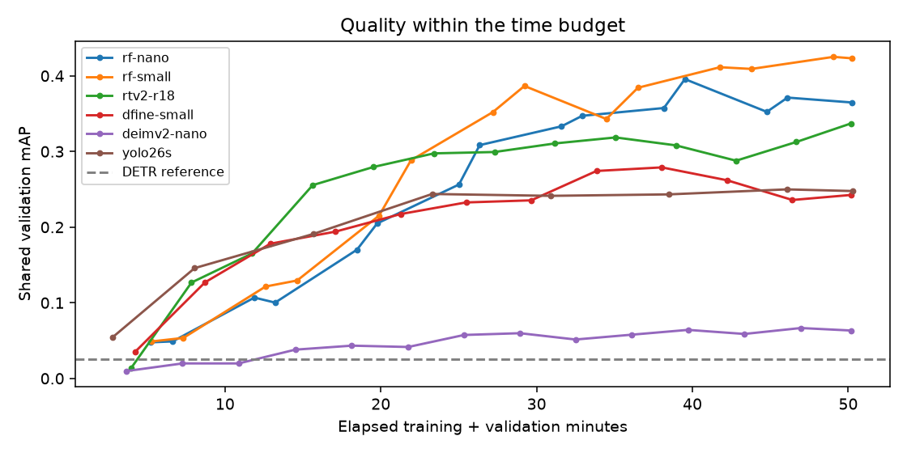
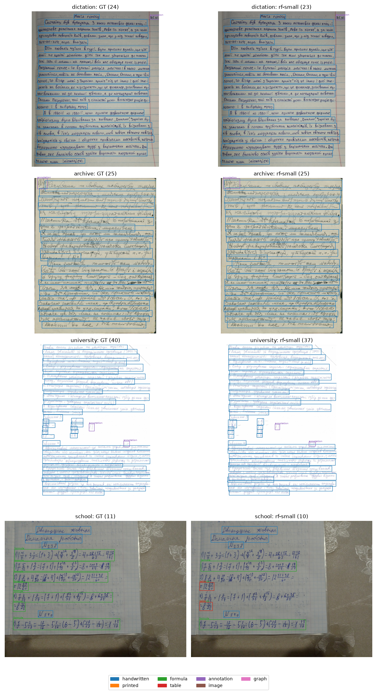

# Detector comparison

50 minutes per model on M3 Pro; 1,197 train / 133 validation pages, seven classes, seed 42. Scores use the best raw-mAP checkpoint.

| Model | mAP | AP50 | Handwritten AP | Box F1 | Line coverage |
| --- | ---: | ---: | ---: | ---: | ---: |
| RF-DETR Small | 0.425 | 0.647 | 0.544 | 0.879 | 86.6% |
| RF-DETR Nano | 0.396 | 0.567 | 0.522 | 0.878 | 87.1% |
| RT-DETRv2 R18 | 0.337 | 0.484 | 0.492 | 0.816 | 80.6% |
| D-FINE Small | 0.279 | 0.418 | 0.487 | 0.793 | 73.0% |
| YOLO26 Small | 0.250 | 0.445 | 0.531 | 0.892 | 90.1% |
| DEIMv2 Nano | 0.067 | 0.128 | 0.168 | 0.491 | 38.0% |

DETR reference: mAP **0.0257**, 10 frozen-backbone epochs (38.9 minutes).

**RF-DETR Small** is selected for longer fine-tuning. **YOLO26 Small** has the highest line coverage and remains an HTR alternative.

mAP averages IoU 0.50–0.95. F1 and line coverage use IoU 0.5 with validation-tuned filtering. One seed, different training recipes; rare classes have few examples. Official test is unused.

