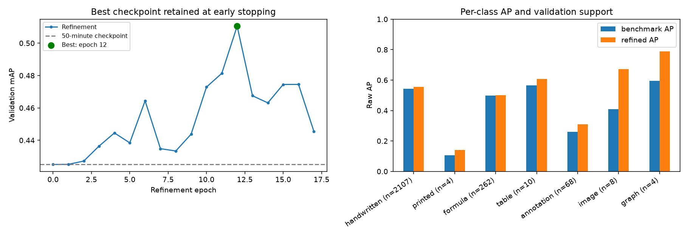
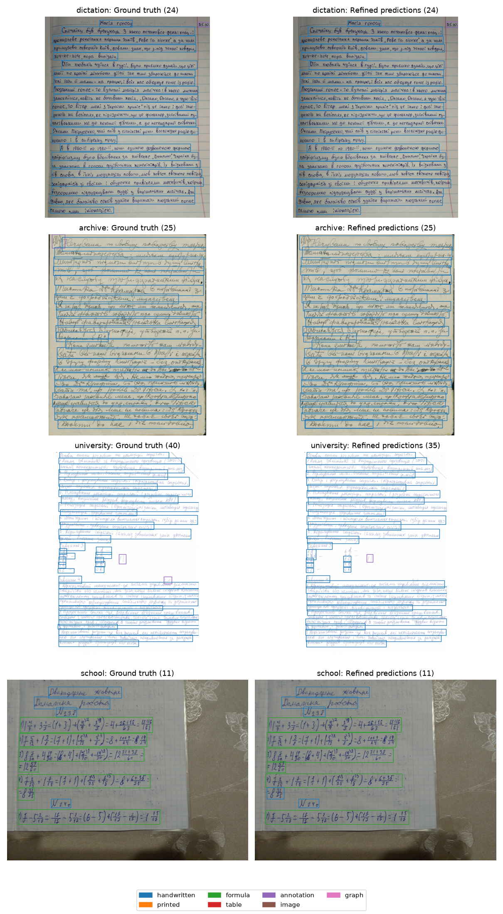
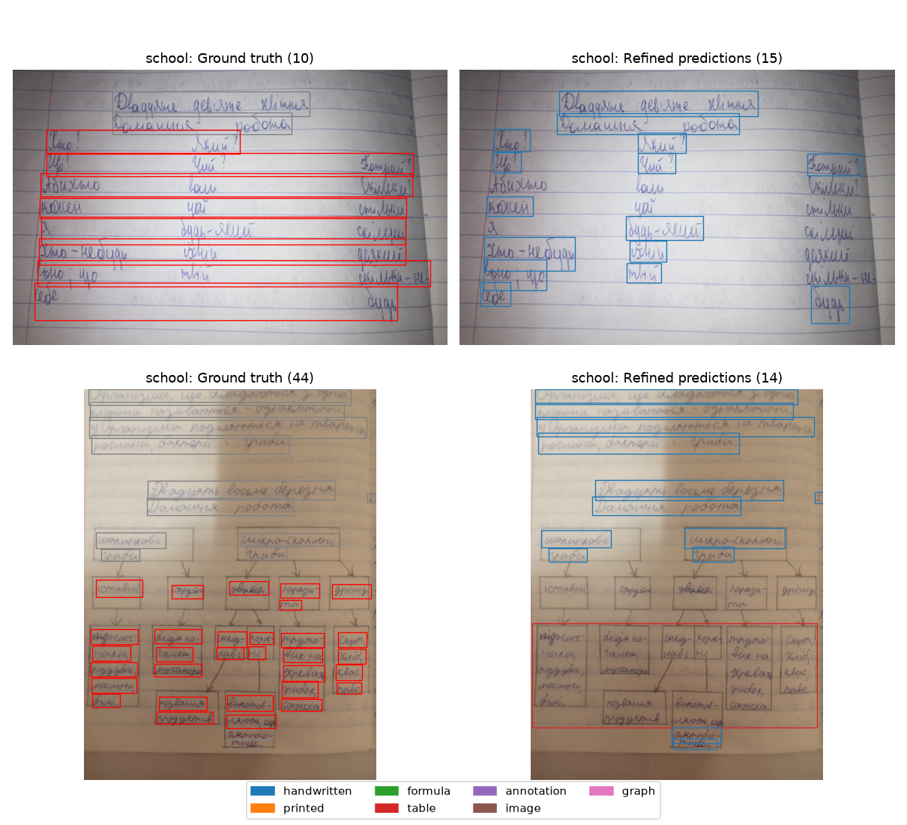

# RF-DETR Small refinement

Early stopping after 17 epochs (120 additional minutes); best checkpoint: epoch 12. Same split and 640-pixel input, 30% learning rates.

| Run | Training | mAP | AP50 | Handwritten AP | Box F1 | Coverage |
| --- | --- | ---: | ---: | ---: | ---: | ---: |
| RF-DETR Small | 50 min | 0.4251 | 0.6475 | 0.5441 | 0.8789 | 86.6% |
| RF-DETR Small refined | 50 + 120 min | 0.5105 | 0.7310 | 0.5543 | 0.9104 | 89.7% |
| YOLO26 Small | 50 min | 0.2499 | 0.4454 | 0.5311 | 0.8924 | 90.1% |

Refinement recovers 64 more eligible handwritten lines than its benchmark checkpoint, with unmatched predictions reduced from 215 to 201. YOLO recovers eight more lines than the refinement, with 51 more unmatched predictions.

About 77% of the mAP gain comes from image/graph AP (only eight/four validation regions). The handwritten AP gain is 0.0102; coverage rises by 3.1 percentage points. One seed and validation-tuned filtering; official test is unused. Failure examples include cross-column splits and a diagram predicted as a table.

